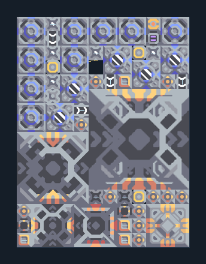

# ยูนิตภาคพื้น T4 — Core น้ำและไครโอในตัว

**SUPPORT205** · 07 ยูนิต · 12×16 ช่อง · **ตรวจผัง**

อัปเกรดครบ T1→T4 พร้อมหล่อเย็น  
ต่อ Unloader กับ Core/คลังที่มีวัสดุ T1–T4 ตรวจพื้น Water Extractor และไฟเพียงพอ; ตั้ง Ground Factory ตามสายที่ต้องการ รอไครโอก่อนเริ่ม T4  
  
แหล่ง: Design-It / plutonium4838  
ต้นฉบับ: t4 2x speed т4  
MIT; แปลชื่อและคู่มือโดยชุด Serpulo ไทย 2.0  
อ่าน/โครงสร้างผ่านแล้ว ผลทดสอบการทำงานเฉพาะรหัสอยู่ในคู่มือ อัตราจริงขึ้นกับแผนที่และวัตถุดิบ  
  
หมวด: 07 ยูนิต • Serpulo ไทย 2.0

**วัสดุก่อสร้าง:** ทองแดง 552 · กราไฟต์ 339 · ตะกั่ว 3579 · เมตากลาส 322 · ผ้าเฟส 620 · พลาสตาเนียม 450 · ซิลิคอน 2178 · ทอเรียม 1525 · ไทเทเนียม 3175

[ดาวน์โหลด .msch](../../schematics/SUPPORT205.msch) · [รหัสนำเข้าจากคลิปบอร์ด](../../codes/SUPPORT205.txt) · [กลับสารบัญ](../INDEX.md)

ภาพประกอบใช้กราฟิกบล็อกจากตัวเกม ไม่ใช่ภาพการรบระหว่างเล่นจริง ทางป้อนต้องจ่ายวัตถุดิบและไฟตามเงื่อนไขที่ระบุ
