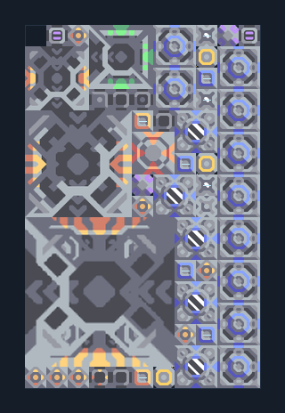

# ยูนิตบิน T4 — Core น้ำ ไครโอ และตัวควบคุม

**SUPPORT206** · 07 ยูนิต · 11×17 ช่อง · **ตรวจผัง**

อัปเกรดถึง T4 พร้อมคุมทรัพยากรและพลังงาน  
วางติด Core/คลังที่มีวัสดุ T1–T4 น้ำจากพื้น ต่อไฟและตรวจ Air Factory plan; ตัวควบคุมและท่อในแบบต้องคงอยู่ เว้นทางออกปลาย Exponential  
มี mlog เดิมฝังในแบบ: ห้ามลบ processor หากยังใช้ระบบอัตโนมัติ; ดูวิธีตั้งค่าของผู้สร้างในคู่มือฉบับเต็ม  
  
แหล่ง: Design-It / justacommonegg  
ต้นฉบับ: T4 Core 1x v1.1  
MIT; แปลชื่อและคู่มือโดยชุด Serpulo ไทย 2.0  
อ่าน/โครงสร้างผ่านแล้ว ผลทดสอบการทำงานเฉพาะรหัสอยู่ในคู่มือ อัตราจริงขึ้นกับแผนที่และวัตถุดิบ  
  
หมวด: 07 ยูนิต • Serpulo ไทย 2.0

**วัสดุก่อสร้าง:** ทองแดง 771 · กราไฟต์ 346 · ตะกั่ว 3713 · เมตากลาส 412 · ผ้าเฟส 630 · พลาสตาเนียม 480 · ซิลิคอน 2227 · ทอเรียม 1400 · ไทเทเนียม 2940

[ดาวน์โหลด .msch](../../schematics/SUPPORT206.msch) · [รหัสนำเข้าจากคลิปบอร์ด](../../codes/SUPPORT206.txt) · [กลับสารบัญ](../INDEX.md)

ภาพประกอบใช้กราฟิกบล็อกจากตัวเกม ไม่ใช่ภาพการรบระหว่างเล่นจริง ทางป้อนต้องจ่ายวัตถุดิบและไฟตามเงื่อนไขที่ระบุ
