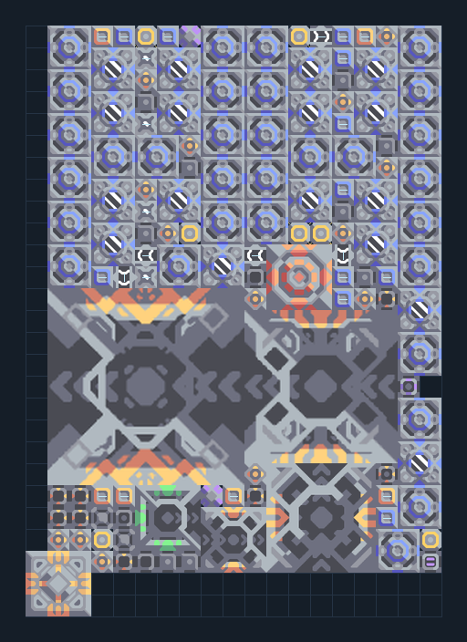

# ยูนิตบิน T5 — ครบโซ่ น้ำและไครโอ

**SUPPORT207** · 07 ยูนิต · 19×27 ช่อง · **ตรวจผัง**

อัปเกรด T1→T5 จาก Core พร้อมระบบหล่อเย็น  
พื้นที่ 19×27; ต่อ Core/คลังที่มีวัสดุ T1–T5 น้ำจากพื้นและไฟสูง; ตรวจ node connections รอไครโอก่อนผลิต ใช้ switch1 หยุด production; FPS/TPS ต่ำอาจลดประสิทธิภาพ  
มี mlog เดิมฝังในแบบ: ห้ามลบ processor หากยังใช้ระบบอัตโนมัติ; ดูวิธีตั้งค่าของผู้สร้างในคู่มือฉบับเต็ม  
  
แหล่ง: Design-It / y0.  
ต้นฉบับ:  Core Tetrative T5  
MIT; แปลชื่อและคู่มือโดยชุด Serpulo ไทย 2.0  
อ่าน/โครงสร้างผ่านแล้ว ผลทดสอบการทำงานเฉพาะรหัสอยู่ในคู่มือ อัตราจริงขึ้นกับแผนที่และวัตถุดิบ  
  
หมวด: 07 ยูนิต • Serpulo ไทย 2.0

**วัสดุก่อสร้าง:** ทองแดง 1453 · กราไฟต์ 1016 · ตะกั่ว 9299 · เมตากลาส 1187 · ผ้าเฟส 1285 · พลาสตาเนียม 1130 · ซิลิคอน 6049 · เซิร์จอัลลอย 920 · ทอเรียม 2525 · ไทเทเนียม 4210

[ดาวน์โหลด .msch](../../schematics/SUPPORT207.msch) · [รหัสนำเข้าจากคลิปบอร์ด](../../codes/SUPPORT207.txt) · [กลับสารบัญ](../INDEX.md)

ภาพประกอบใช้กราฟิกบล็อกจากตัวเกม ไม่ใช่ภาพการรบระหว่างเล่นจริง ทางป้อนต้องจ่ายวัตถุดิบและไฟตามเงื่อนไขที่ระบุ
