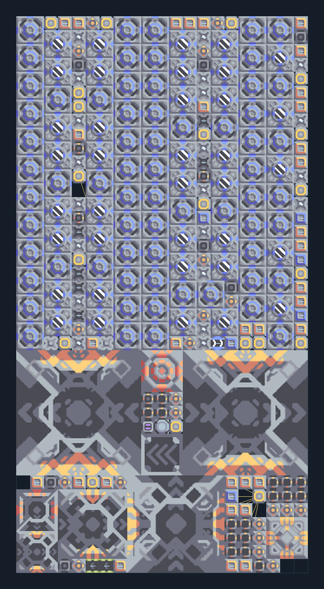

# ยูนิตภาคพื้น T5 — สองเครื่องปลายทาง ไม่มี logic

**SUPPORT208** · 07 ยูนิต · 21×40 ช่อง · **ตรวจผัง**

ขยาย T5 จาก Core แบบไม่พึ่ง processor  
พื้นที่ยาว 21×40 ใช้วัสดุยูนิต T1–T5 จาก Core/คลังและไฟสูง; มีน้ำ/ไครโอจำนวนมากในตัว ตรวจพื้นและ payload router; ไม่เหมาะเป็นฐานต้นเกม  
  
แหล่ง: Design-It / 1000mistakes  
ต้นฉบับ: ground t5 logicless on core  
MIT; แปลชื่อและคู่มือโดยชุด Serpulo ไทย 2.0  
อ่าน/โครงสร้างผ่านแล้ว ผลทดสอบการทำงานเฉพาะรหัสอยู่ในคู่มือ อัตราจริงขึ้นกับแผนที่และวัตถุดิบ  
  
หมวด: 07 ยูนิต • Serpulo ไทย 2.0

**วัสดุก่อสร้าง:** ทองแดง 2397 · กราไฟต์ 2424 · ตะกั่ว 16015 · เมตากลาส 2285 · ผ้าเฟส 1995 · พลาสตาเนียม 1732 · ซิลิคอน 10139 · เซิร์จอัลลอย 1720 · ทอเรียม 3525 · ไทเทเนียม 5543

[ดาวน์โหลด .msch](../../schematics/SUPPORT208.msch) · [รหัสนำเข้าจากคลิปบอร์ด](../../codes/SUPPORT208.txt) · [กลับสารบัญ](../INDEX.md)

ภาพประกอบใช้กราฟิกบล็อกจากตัวเกม ไม่ใช่ภาพการรบระหว่างเล่นจริง ทางป้อนต้องจ่ายวัตถุดิบและไฟตามเงื่อนไขที่ระบุ
