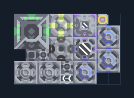

# Flare จาก Scrap — โรงงานและวัตถุดิบในตัว

**SUPPORT209** · 07 ยูนิต · 9×6 ช่อง · **ตรวจผัง**

ผลิต T1 Flare โดยใช้เศษวัสดุในพื้นที่  
วาง Pneumatic Drill บน Scrap; น้ำจากพื้นและไฟภายนอก มีทราย ถ่านหินและซิลิคอนในตัว เว้นทางออก Air Factory  
  
แหล่ง: Design-It / justacommonegg  
ต้นฉบับ: T1 Flare on Scrap (54)  
MIT; แปลชื่อและคู่มือโดยชุด Serpulo ไทย 2.0  
อ่าน/โครงสร้างผ่านแล้ว ผลทดสอบการทำงานเฉพาะรหัสอยู่ในคู่มือ อัตราจริงขึ้นกับแผนที่และวัตถุดิบ  
  
หมวด: 07 ยูนิต • Serpulo ไทย 2.0

**วัสดุก่อสร้าง:** ทองแดง 305 · กราไฟต์ 150 · ตะกั่ว 333 · เมตากลาส 91 · ซิลิคอน 100 · ไทเทเนียม 20

[ดาวน์โหลด .msch](../../schematics/SUPPORT209.msch) · [รหัสนำเข้าจากคลิปบอร์ด](../../codes/SUPPORT209.txt) · [กลับสารบัญ](../INDEX.md)

ภาพประกอบใช้กราฟิกบล็อกจากตัวเกม ไม่ใช่ภาพการรบระหว่างเล่นจริง ทางป้อนต้องจ่ายวัตถุดิบและไฟตามเงื่อนไขที่ระบุ
