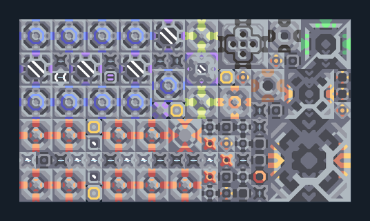

# ยูนิต T3 จาก Scrap — แยกแร่ครบโซ่

**SUPPORT210** · 07 ยูนิต · 20×11 ช่อง · **ตรวจผัง**

แปลง Scrap เป็นวัสดุและยูนิต T3  
ป้อน Scrap เข้าสายพานตามภาพ มีแยกแร่และโรงงานวัสดุในตัว ต่อไฟ น้ำจากพื้น และทางระบายส่วนเกิน; processor จัดการระบบ รอวัสดุเต็มก่อนวัดการผลิต  
มี mlog เดิมฝังในแบบ: ห้ามลบ processor หากยังใช้ระบบอัตโนมัติ; ดูวิธีตั้งค่าของผู้สร้างในคู่มือฉบับเต็ม  
  
แหล่ง: Design-It / justacommonegg  
ต้นฉบับ: T3 Scrap (220)  
MIT; แปลชื่อและคู่มือโดยชุด Serpulo ไทย 2.0  
อ่าน/โครงสร้างผ่านแล้ว ผลทดสอบการทำงานเฉพาะรหัสอยู่ในคู่มือ อัตราจริงขึ้นกับแผนที่และวัตถุดิบ  
  
หมวด: 07 ยูนิต • Serpulo ไทย 2.0

**วัสดุก่อสร้าง:** ทองแดง 1495 · กราไฟต์ 557 · ตะกั่ว 1904 · เมตากลาส 403 · พลาสตาเนียม 65 · ซิลิคอน 975 · ทอเรียม 650 · ไทเทเนียม 910

[ดาวน์โหลด .msch](../../schematics/SUPPORT210.msch) · [รหัสนำเข้าจากคลิปบอร์ด](../../codes/SUPPORT210.txt) · [กลับสารบัญ](../INDEX.md)

ภาพประกอบใช้กราฟิกบล็อกจากตัวเกม ไม่ใช่ภาพการรบระหว่างเล่นจริง ทางป้อนต้องจ่ายวัตถุดิบและไฟตามเงื่อนไขที่ระบุ
