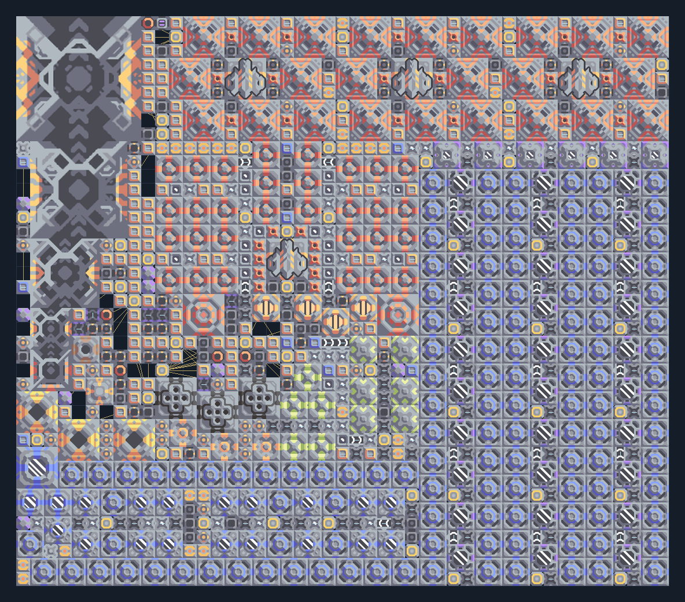

# ยูนิต T5 จาก Scrap — ฐานโรงงานครบวงจร

**SUPPORT211** · 07 ยูนิต · 47×41 ช่อง · **ตรวจผัง**

ผลิตวัสดุและอัปเกรดยูนิตถึง T5 จาก Scrap  
แบบใหญ่ 47×41 ต้องป้อน Scrap ผ่าน Mass Driver ทุกจุดที่ใช้รับวัตถุดิบ ต่อไฟสูงและพื้นขุดน้ำได้; อ่านแผนผัง/ข้อความทุกส่วนก่อนเริ่ม เหมาะฐานผลิตท้ายเกม  
มี mlog เดิมฝังในแบบ: ห้ามลบ processor หากยังใช้ระบบอัตโนมัติ; ดูวิธีตั้งค่าของผู้สร้างในคู่มือฉบับเต็ม  
  
แหล่ง: Design-It / y0.  
ต้นฉบับ: T5 Scrap 1x (1927) v2.1  
MIT; แปลชื่อและคู่มือโดยชุด Serpulo ไทย 2.0  
อ่าน/โครงสร้างผ่านแล้ว ผลทดสอบการทำงานเฉพาะรหัสอยู่ในคู่มือ อัตราจริงขึ้นกับแผนที่และวัตถุดิบ  
  
หมวด: 07 ยูนิต • Serpulo ไทย 2.0

**วัสดุก่อสร้าง:** ทองแดง 8193 · กราไฟต์ 6878 · ตะกั่ว 19067 · เมตากลาส 4607 · ผ้าเฟส 1775 · พลาสตาเนียม 2281 · ซิลิคอน 13465 · เซิร์จอัลลอย 1040 · ทอเรียม 5036 · ไทเทเนียม 9220

[ดาวน์โหลด .msch](../../schematics/SUPPORT211.msch) · [รหัสนำเข้าจากคลิปบอร์ด](../../codes/SUPPORT211.txt) · [กลับสารบัญ](../INDEX.md)

ภาพประกอบใช้กราฟิกบล็อกจากตัวเกม ไม่ใช่ภาพการรบระหว่างเล่นจริง ทางป้อนต้องจ่ายวัตถุดิบและไฟตามเงื่อนไขที่ระบุ
