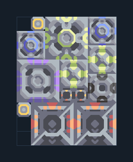

# Crawler คู่ — ทราย น้ำมันและซิลิคอนในตัว

**SUPPORT212** · 07 ยูนิต · 7×9 ช่อง · **ตรวจผัง**

ยูนิต T1 จากเหมืองทรายและน้ำมันพื้น  
วาง Laser Drill บนทรายและ Oil Extractor บนพื้นที่มีค่าน้ำมัน น้ำจากพื้น ต่อไฟ มีซิลิคอนและถ่านหินในผัง เว้นทางออก Ground Factory  
  
แหล่ง: Design-It / justacommonegg  
ต้นฉบับ: T1 Crawler Ws 2x (63)  
MIT; แปลชื่อและคู่มือโดยชุด Serpulo ไทย 2.0  
อ่าน/โครงสร้างผ่านแล้ว ผลทดสอบการทำงานเฉพาะรหัสอยู่ในคู่มือ อัตราจริงขึ้นกับแผนที่และวัตถุดิบ  
  
หมวด: 07 ยูนิต • Serpulo ไทย 2.0

**วัสดุก่อสร้าง:** ทองแดง 383 · กราไฟต์ 345 · ตะกั่ว 516 · เมตากลาส 60 · ซิลิคอน 265 · ทอเรียม 115 · ไทเทเนียม 60

[ดาวน์โหลด .msch](../../schematics/SUPPORT212.msch) · [รหัสนำเข้าจากคลิปบอร์ด](../../codes/SUPPORT212.txt) · [กลับสารบัญ](../INDEX.md)

ภาพประกอบใช้กราฟิกบล็อกจากตัวเกม ไม่ใช่ภาพการรบระหว่างเล่นจริง ทางป้อนต้องจ่ายวัตถุดิบและไฟตามเงื่อนไขที่ระบุ
