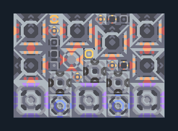

# Dagger 6 โรงงาน — ทรายและถ่านหิน

**SUPPORT213** · 07 ยูนิต · 13×9 ช่อง · **ตรวจผัง**

กองยูนิต T1 พร้อมผลิตซิลิคอนเอง  
วางเหมืองบนทราย/ถ่านหินตามผัง ป้อนตะกั่วทางมุมซ้ายบน ต่อไฟและน้ำจากพื้น ตรวจ Ground Factory เป็น Dagger; ไม่ต้องใช้ทอเรียม  
  
แหล่ง: Design-It / triactum  
ต้นฉบับ: Pre - Thor T1 Dagger (117)  
MIT; แปลชื่อและคู่มือโดยชุด Serpulo ไทย 2.0  
อ่าน/โครงสร้างผ่านแล้ว ผลทดสอบการทำงานเฉพาะรหัสอยู่ในคู่มือ อัตราจริงขึ้นกับแผนที่และวัตถุดิบ  
  
หมวด: 07 ยูนิต • Serpulo ไทย 2.0

**วัสดุก่อสร้าง:** ทองแดง 579 · กราไฟต์ 150 · ตะกั่ว 991 · เมตากลาส 60 · พลาสตาเนียม 30 · ซิลิคอน 765 · ไทเทเนียม 235

[ดาวน์โหลด .msch](../../schematics/SUPPORT213.msch) · [รหัสนำเข้าจากคลิปบอร์ด](../../codes/SUPPORT213.txt) · [กลับสารบัญ](../INDEX.md)

ภาพประกอบใช้กราฟิกบล็อกจากตัวเกม ไม่ใช่ภาพการรบระหว่างเล่นจริง ทางป้อนต้องจ่ายวัตถุดิบและไฟตามเงื่อนไขที่ระบุ
