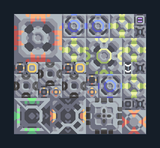

# ยูนิต T2 — ผลิตวัสดุบนทรายดำ

**SUPPORT214** · 07 ยูนิต · 11×10 ช่อง · **ตรวจผัง**

โซ่ T1→T2 ที่มีถ่านหิน กราไฟต์ ซิลิคอนในตัว  
วาง Airblast บนทรายดำและ Oil Extractor บนพื้นมีน้ำมัน ตรวจน้ำจากพื้น ต่อไฟและเลือกชนิด Air Factory; การเปลี่ยนเป็นสายภาคพื้นต้องเปลี่ยน factory ตามระบบเกม  
  
แหล่ง: Design-It / y0.  
ต้นฉบับ: T2 BS 1x Attack v1.0  
MIT; แปลชื่อและคู่มือโดยชุด Serpulo ไทย 2.0  
อ่าน/โครงสร้างผ่านแล้ว ผลทดสอบการทำงานเฉพาะรหัสอยู่ในคู่มือ อัตราจริงขึ้นกับแผนที่และวัตถุดิบ  
  
หมวด: 07 ยูนิต • Serpulo ไทย 2.0

**วัสดุก่อสร้าง:** ทองแดง 698 · กราไฟต์ 480 · ตะกั่ว 830 · เมตากลาส 91 · พลาสตาเนียม 30 · ซิลิคอน 445 · ทอเรียม 190 · ไทเทเนียม 355

[ดาวน์โหลด .msch](../../schematics/SUPPORT214.msch) · [รหัสนำเข้าจากคลิปบอร์ด](../../codes/SUPPORT214.txt) · [กลับสารบัญ](../INDEX.md)

ภาพประกอบใช้กราฟิกบล็อกจากตัวเกม ไม่ใช่ภาพการรบระหว่างเล่นจริง ทางป้อนต้องจ่ายวัตถุดิบและไฟตามเงื่อนไขที่ระบุ
