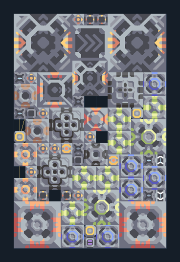

# ยูนิต T3 คู่ — โรงงานบนทรายดำ

**SUPPORT215** · 07 ยูนิต · 13×20 ช่อง · **ตรวจผัง**

วัสดุยูนิตและสองสายอัปเกรด T3 ในผัง  
วางหัวขุดบนทรายดำ น้ำมัน/น้ำจากพื้น ป้อนตะกั่วและไทเทเนียมที่ผังไม่ได้ขุด; ต่อไฟและตรวจ Ground Factory plan กับ Payload Router  
  
แหล่ง: Design-It / artyomic_  
ต้นฉบับ: double t3 bs (again)  
MIT; แปลชื่อและคู่มือโดยชุด Serpulo ไทย 2.0  
อ่าน/โครงสร้างผ่านแล้ว ผลทดสอบการทำงานเฉพาะรหัสอยู่ในคู่มือ อัตราจริงขึ้นกับแผนที่และวัตถุดิบ  
  
หมวด: 07 ยูนิต • Serpulo ไทย 2.0

**วัสดุก่อสร้าง:** ทองแดง 1189 · กราไฟต์ 900 · ตะกั่ว 2571 · เมตากลาส 342 · พลาสตาเนียม 100 · ซิลิคอน 1800 · ทอเรียม 1680 · ไทเทเนียม 1535

[ดาวน์โหลด .msch](../../schematics/SUPPORT215.msch) · [รหัสนำเข้าจากคลิปบอร์ด](../../codes/SUPPORT215.txt) · [กลับสารบัญ](../INDEX.md)

ภาพประกอบใช้กราฟิกบล็อกจากตัวเกม ไม่ใช่ภาพการรบระหว่างเล่นจริง ทางป้อนต้องจ่ายวัตถุดิบและไฟตามเงื่อนไขที่ระบุ
