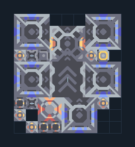

# เรือ Oxynoe — โรงงาน T2 ติด Core

**SUPPORT216** · 07 ยูนิต · 9×10 ช่อง · **ตรวจผัง**

สายเรือสนับสนุน T1→T2 จากคลัง  
Naval Factory ทั้งตัวต้องอยู่บนน้ำ ต่อ Unloader กับ Core/คลังที่มีวัสดุ Retusa และ T2 ต่อไฟ; ตั้งโรงงาน Retusa และเว้นเส้นทางออกสู่แหล่งน้ำ  
  
แหล่ง: Design-It / justacommonegg  
ต้นฉบับ: t2 oxynoe core  
MIT; แปลชื่อและคู่มือโดยชุด Serpulo ไทย 2.0  
อ่าน/โครงสร้างผ่านแล้ว ผลทดสอบการทำงานเฉพาะรหัสอยู่ในคู่มือ อัตราจริงขึ้นกับแผนที่และวัตถุดิบ  
  
หมวด: 07 ยูนิต • Serpulo ไทย 2.0

**วัสดุก่อสร้าง:** ทองแดง 983 · กราไฟต์ 10 · ตะกั่ว 894 · เมตากลาส 600 · พลาสตาเนียม 30 · ซิลิคอน 315 · ไทเทเนียม 200

[ดาวน์โหลด .msch](../../schematics/SUPPORT216.msch) · [รหัสนำเข้าจากคลิปบอร์ด](../../codes/SUPPORT216.txt) · [กลับสารบัญ](../INDEX.md)

ภาพประกอบใช้กราฟิกบล็อกจากตัวเกม ไม่ใช่ภาพการรบระหว่างเล่นจริง ทางป้อนต้องจ่ายวัตถุดิบและไฟตามเงื่อนไขที่ระบุ
