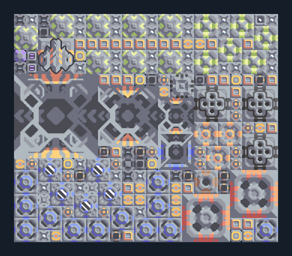

# เรือ T4 — โรงงานวัตถุดิบบนทรายและน้ำ

**SUPPORT217** · 07 ยูนิต · 22×19 ช่อง · **ตรวจผัง**

ผลิตและอัปเกรดเรือถึง T4 พร้อมไครโอ  
Naval Factory อยู่บนน้ำ หัวขุดบนทราย น้ำมัน/ไทเทเนียมป้อนจากภายนอกผ่านพอร์ตและ Mass Driver ตามผัง; ต่อไฟและเลือก Risso/Retusa ตรวจช่องปล่อยเรือในน้ำ  
มี mlog เดิมฝังในแบบ: ห้ามลบ processor หากยังใช้ระบบอัตโนมัติ; ดูวิธีตั้งค่าของผู้สร้างในคู่มือฉบับเต็ม  
  
แหล่ง: Design-It / plent  
ต้นฉบับ: T4 SO 1x (418) v1.3  
MIT; แปลชื่อและคู่มือโดยชุด Serpulo ไทย 2.0  
อ่าน/โครงสร้างผ่านแล้ว ผลทดสอบการทำงานเฉพาะรหัสอยู่ในคู่มือ อัตราจริงขึ้นกับแผนที่และวัตถุดิบ  
  
หมวด: 07 ยูนิต • Serpulo ไทย 2.0

**วัสดุก่อสร้าง:** ทองแดง 1369 · กราไฟต์ 1512 · ตะกั่ว 5611 · เมตากลาส 978 · ผ้าเฟส 730 · พลาสตาเนียม 555 · ซิลิคอน 3407 · ทอเรียม 1600 · ไทเทเนียม 4345

[ดาวน์โหลด .msch](../../schematics/SUPPORT217.msch) · [รหัสนำเข้าจากคลิปบอร์ด](../../codes/SUPPORT217.txt) · [กลับสารบัญ](../INDEX.md)

ภาพประกอบใช้กราฟิกบล็อกจากตัวเกม ไม่ใช่ภาพการรบระหว่างเล่นจริง ทางป้อนต้องจ่ายวัตถุดิบและไฟตามเงื่อนไขที่ระบุ
