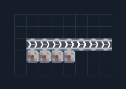

# ปั๊มเริ่มต้น — ของเหลวพื้น 4 ตัวไม่ใช้ไฟ

**SUPPORT301** · 02 เหมืองและปั๊ม · 8×5 ช่อง · **ตรวจผัง**

ปั๊มน้ำหรือน้ำมันจากพื้นโดยไม่ใช้ไฟ  
วาง Mechanical Pump ทั้งสี่ตัวบนของเหลวชนิดเดียวกัน ต่อสายท่อด้านขวาไปฐาน; ห้ามต่อท่อกับของเหลวอีกชนิด ใช้เริ่ม Steam หรือรับน้ำเบาๆ  
  
จุดต่อก่อนหมุน (0,0 มุมซ้ายล่าง):  
ของเหลวออก ตรวจชนิดพื้นทุกปั๊ม @ 7,2  
Serpulo • ไทย 2.0 • บล็อกเดิม • สร้างใหม่  
สถานะ: โครงสร้าง; ยังไม่ยืนยันการต่อสู้/กำลังผลิตจริง  
  
หมวด: 02 เหมืองและปั๊ม • Serpulo ไทย 2.0

**วัสดุก่อสร้าง:** ทองแดง 60 · เมตากลาส 47

[ดาวน์โหลด .msch](../../schematics/SUPPORT301.msch) · [รหัสนำเข้าจากคลิปบอร์ด](../../codes/SUPPORT301.txt) · [กลับสารบัญ](../INDEX.md)

ภาพประกอบใช้กราฟิกบล็อกจากตัวเกม ไม่ใช่ภาพการรบระหว่างเล่นจริง ทางป้อนต้องจ่ายวัตถุดิบและไฟตามเงื่อนไขที่ระบุ
