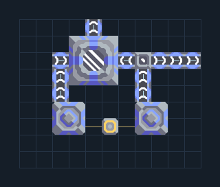

# ปั๊มโรตารีคู่ — ถังพักและสองทางออก

**SUPPORT302** · 02 เหมืองและปั๊ม · 11×9 ช่อง · **ทดสอบระบบ**

เพิ่มน้ำ/น้ำมันจากแหล่งน้ำพร้อมบัฟเฟอร์  
วางปั๊มเต็มพื้นที่บนน้ำหรือแหล่งน้ำมันชนิดเดียวกัน ต่อไฟ ถังพักไม่ผลิตของเหลว ใช้ทางออกแยกเมื่อท่อเดียวจำกัดการไหล  
  
จุดต่อก่อนหมุน (0,0 มุมซ้ายล่าง):  
ของเหลวออกทางขวา @ 10,6  
ของเหลวออกด้านบน @ 4,8  
ไฟปั๊มคู่ @ 5,2  
Serpulo • ไทย 2.0 • บล็อกเดิม • สร้างใหม่  
  
ผลทดสอบ Build 160.7: water 96.00/วินาที เมื่อป้อนวัตถุดิบที่จุดต่อและมีไฟครบ  
  
หมวด: 02 เหมืองและปั๊ม • Serpulo ไทย 2.0

**วัสดุก่อสร้าง:** ทองแดง 142 · กราไฟต์ 4 · ตะกั่ว 6 · เมตากลาส 152 · ซิลิคอน 40 · ไทเทเนียม 120

[ดาวน์โหลด .msch](../../schematics/SUPPORT302.msch) · [รหัสนำเข้าจากคลิปบอร์ด](../../codes/SUPPORT302.txt) · [กลับสารบัญ](../INDEX.md)

ภาพประกอบใช้กราฟิกบล็อกจากตัวเกม ไม่ใช่ภาพการรบระหว่างเล่นจริง ทางป้อนต้องจ่ายวัตถุดิบและไฟตามเงื่อนไขที่ระบุ
