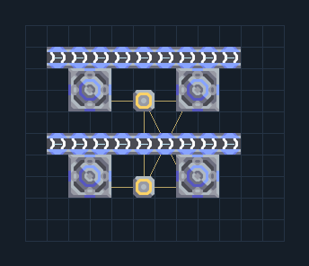

# ขุดน้ำใต้ดิน 4 เครื่อง — แยกท่อออก

**SUPPORT303** · 09 สนับสนุนและ Logic · 12×10 ช่อง · **ทดสอบระบบ**

น้ำสำหรับฐานบนพื้นแห้งที่ขุดน้ำได้  
ตรวจเปอร์เซ็นต์น้ำของพื้นก่อนวาง ต่อไฟและต่อทางออกทั้งสองเส้นตามภาระ; ผลผลิตจริงขึ้นกับพื้น ไม่เท่ากับปั๊มบนแหล่งน้ำ  
  
จุดต่อก่อนหมุน (0,0 มุมซ้ายล่าง):  
น้ำออกคู่ล่าง @ 9,4  
น้ำออกคู่บน @ 9,8  
ไฟเครื่องขุดน้ำ @ 5,2  
Serpulo • ไทย 2.0 • บล็อกเดิม • สร้างใหม่  
  
ผลทดสอบ Build 160.7: water 26.40/วินาที เมื่อป้อนวัตถุดิบที่จุดต่อและมีไฟครบ  
  
หมวด: 09 สนับสนุนและ Logic • Serpulo ไทย 2.0

**วัสดุก่อสร้าง:** ทองแดง 124 · กราไฟต์ 120 · ตะกั่ว 132 · เมตากลาส 138 · ไทเทเนียม 36

[ดาวน์โหลด .msch](../../schematics/SUPPORT303.msch) · [รหัสนำเข้าจากคลิปบอร์ด](../../codes/SUPPORT303.txt) · [กลับสารบัญ](../INDEX.md)

ภาพประกอบใช้กราฟิกบล็อกจากตัวเกม ไม่ใช่ภาพการรบระหว่างเล่นจริง ทางป้อนต้องจ่ายวัตถุดิบและไฟตามเงื่อนไขที่ระบุ
