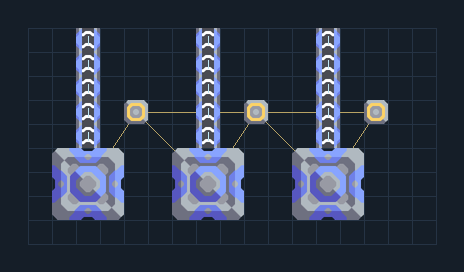

# ปั๊มอิมพัลส์ 3 ตัว — แยกน้ำสามทาง

**SUPPORT304** · 02 เหมืองและปั๊ม · 17×9 ช่อง · **ตรวจผัง**

น้ำอัตราสูงสำหรับฐานรับ/ไครโอขนาดใหญ่  
พื้นที่ปั๊มทุกช่องต้องอยู่บนน้ำชนิดเดียวกัน ต่อไฟและแยกท่อออกสามเส้นถึงปลายทาง ไม่รวมเป็นท่อเดียวถ้าน้ำไม่ทัน  
  
จุดต่อก่อนหมุน (0,0 มุมซ้ายล่าง):  
น้ำออกปั๊ม 1 @ 2,8  
น้ำออกปั๊ม 2 @ 7,8  
น้ำออกปั๊ม 3 @ 12,8  
ไฟปั๊มทั้งสาม @ 4,5  
Serpulo • ไทย 2.0 • บล็อกเดิม • สร้างใหม่  
สถานะ: โครงสร้าง; ยังไม่ยืนยันการต่อสู้/กำลังผลิตจริง  
  
หมวด: 02 เหมืองและปั๊ม • Serpulo ไทย 2.0

**วัสดุก่อสร้าง:** ทองแดง 246 · ตะกั่ว 18 · เมตากลาส 285 · ซิลิคอน 90 · ทอเรียม 105 · ไทเทเนียม 150

[ดาวน์โหลด .msch](../../schematics/SUPPORT304.msch) · [รหัสนำเข้าจากคลิปบอร์ด](../../codes/SUPPORT304.txt) · [กลับสารบัญ](../INDEX.md)

ภาพประกอบใช้กราฟิกบล็อกจากตัวเกม ไม่ใช่ภาพการรบระหว่างเล่นจริง ทางป้อนต้องจ่ายวัตถุดิบและไฟตามเงื่อนไขที่ระบุ
