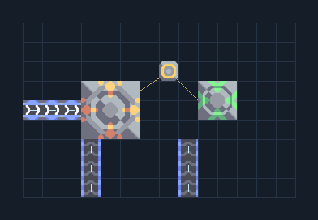

# โล่และซ่อม — ระบบน้ำและผ้าเฟสภายนอก

**SUPPORT305** · 09 สนับสนุนและ Logic · 14×9 ช่อง · **ตรวจผัง**

ป้องกันกลุ่มปืนหรือโรงงานท้ายเกม  
ต่อไฟให้ Force Projector/Mend Projector ต่อไครโอและผ้าเฟสตามพอร์ต; วางหลังแนวกำแพง เมื่อของเหลว/ผ้าเฟสไม่พอใช้ได้ตามกำลังพื้นฐานของบล็อก  
  
จุดต่อก่อนหมุน (0,0 มุมซ้ายล่าง):  
ผ้าเฟสเข้าโล่ (ตัวเลือกเพิ่มประสิทธิภาพ) @ 3,0  
ผ้าเฟสเข้าซ่อม (ตัวเลือก) @ 8,0  
ไครโอเข้าโล่ @ 0,4  
ไฟโล่และซ่อม @ 7,6  
Serpulo • ไทย 2.0 • บล็อกเดิม • สร้างใหม่  
สถานะ: โครงสร้าง; ยังไม่ยืนยันการต่อสู้/กำลังผลิตจริง  
  
หมวด: 09 สนับสนุนและ Logic • Serpulo ไทย 2.0

**วัสดุก่อสร้าง:** ทองแดง 58 · ตะกั่ว 212 · เมตากลาส 3 · ซิลิคอน 165 · ไทเทเนียม 112

[ดาวน์โหลด .msch](../../schematics/SUPPORT305.msch) · [รหัสนำเข้าจากคลิปบอร์ด](../../codes/SUPPORT305.txt) · [กลับสารบัญ](../INDEX.md)

ภาพประกอบใช้กราฟิกบล็อกจากตัวเกม ไม่ใช่ภาพการรบระหว่างเล่นจริง ทางป้อนต้องจ่ายวัตถุดิบและไฟตามเงื่อนไขที่ระบุ
