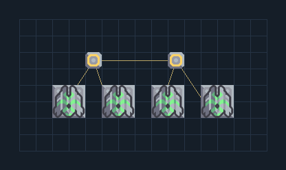

# จุดซ่อมยูนิต — 4 ป้อมพร้อมไฟ

**SUPPORT306** · 09 สนับสนุนและ Logic · 15×8 ช่อง · **ตรวจผัง**

จุดพักและซ่อมยูนิตที่ควบคุมร่วมกับทีม  
ต่อไฟและตั้ง rally ของยูนิตใกล้พื้นที่ว่างด้านบนของแบบ มี Repair Turret สี่ตัว ผังนี้ไม่ดึง/ยึดควบคุมยูนิตของเพื่อน  
  
จุดต่อก่อนหมุน (0,0 มุมซ้ายล่าง):  
ไฟป้อมซ่อมยูนิต @ 4,5  
Serpulo • ไทย 2.0 • บล็อกเดิม • สร้างใหม่  
สถานะ: โครงสร้าง; ยังไม่ยืนยันการต่อสู้/กำลังผลิตจริง  
  
หมวด: 09 สนับสนุนและ Logic • Serpulo ไทย 2.0

**วัสดุก่อสร้าง:** ทองแดง 4 · ตะกั่ว 12 · พลาสตาเนียม 240 · ซิลิคอน 360 · ทอเรียม 320

[ดาวน์โหลด .msch](../../schematics/SUPPORT306.msch) · [รหัสนำเข้าจากคลิปบอร์ด](../../codes/SUPPORT306.txt) · [กลับสารบัญ](../INDEX.md)

ภาพประกอบใช้กราฟิกบล็อกจากตัวเกม ไม่ใช่ภาพการรบระหว่างเล่นจริง ทางป้อนต้องจ่ายวัตถุดิบและไฟตามเงื่อนไขที่ระบุ
