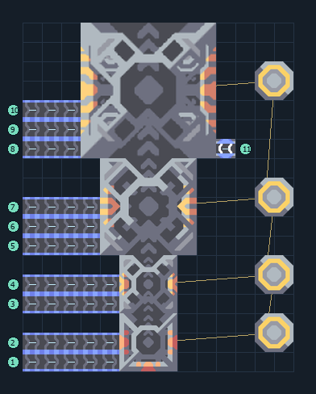

# scepter — สายผลิตถึง T4

**UNIT-DAGGER-T4** · 07 ยูนิต · 14×18 ช่อง · **ทดสอบระบบ**

DAGGER T4  
โรงงานและเครื่องอัปเกรดต่อ payload ไว้ครบ เลือกยูนิตเริ่มต้นแล้ว เว้นพื้นที่ด้านบนให้ยูนิตออก  
ต่อวัตถุดิบเข้าขอบซ้ายแต่ละสายที่กำหนด ต้องมี Core และโควตายูนิต; รุ่น T4/T5 ต้องป้อนไครโอแยกแต่ละขั้น  
เหมาะเมื่อวางสายผลิตอัปเกรดแยกจากโรงงานวัตถุดิบ  
  
เข้า ซิลิคอน ที่ (0,0) → ขั้น T1 ใช้ 10/รอบ  
เข้า ตะกั่ว ที่ (0,1) → ขั้น T1 ใช้ 10/รอบ  
เชื่อมไฟที่เสา (12,1)  
เข้า ซิลิคอน ที่ (0,3) → ขั้น T2 ใช้ 40/รอบ  
เข้า กราไฟต์ ที่ (0,4) → ขั้น T2 ใช้ 40/รอบ  
เข้า ซิลิคอน ที่ (0,6) → ขั้น T3 ใช้ 130/รอบ  
เข้า ไทเทเนียม ที่ (0,7) → ขั้น T3 ใช้ 80/รอบ  
เข้า เมตากลาส ที่ (0,8) → ขั้น T3 ใช้ 40/รอบ  
เข้า ซิลิคอน ที่ (0,11) → ขั้น T4 ใช้ 850/รอบ  
เข้า ไทเทเนียม ที่ (0,12) → ขั้น T4 ใช้ 750/รอบ  
เข้า พลาสตาเนียม ที่ (0,13) → ขั้น T4 ใช้ 650/รอบ  
เข้า ไครโอฟลูอิด ที่ (10,11) → T4 ต้องมี 60/วินาที  
ยูนิตออกด้านบนสุด; ต้นทุนและทรัพยากรแต่ละขั้นเพิ่มตามระดับ  
พิกัดจากซ้ายล่างเริ่ม 0 ก่อนหมุน  
ใช้ไฟสูงสุดตามสูตรรวมประมาณ 1392/วินาทีเมื่อเครื่องทำงานพร้อมกัน  
  
ผลทดสอบ Build 160.7: สร้าง scepter ออกมาจริง 10 ตัวใน 1000 วินาที จากสายผลิตครบขั้น; ทดสอบการผลิต ไม่ใช่การรบ  
  
หมวด: 07 ยูนิต • Serpulo ไทย 2.0

**วัสดุก่อสร้าง:** ทองแดง 291 · ตะกั่ว 2971 · เมตากลาส 1 · ผ้าเฟส 600 · พลาสตาเนียม 450 · ซิลิคอน 1632 · ทอเรียม 1400 · ไทเทเนียม 2413

[ดาวน์โหลด .msch](../../schematics/UNIT-DAGGER-T4.msch) · [รหัสนำเข้าจากคลิปบอร์ด](../../codes/UNIT-DAGGER-T4.txt) · [กลับสารบัญ](../INDEX.md)

ภาพประกอบใช้กราฟิกบล็อกจากตัวเกม ไม่ใช่ภาพการรบระหว่างเล่นจริง ทางป้อนต้องจ่ายวัตถุดิบและไฟตามเงื่อนไขที่ระบุ
