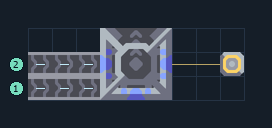

# risso — สายผลิตถึง T1

**UNIT-RISSO-T1** · 07 ยูนิต · 9×3 ช่อง · **ทดสอบระบบ**

RISSO T1  
โรงงานและเครื่องอัปเกรดต่อ payload ไว้ครบ เลือกยูนิตเริ่มต้นแล้ว เว้นพื้นที่ด้านบนให้ยูนิตออก  
ต่อวัตถุดิบเข้าขอบซ้ายแต่ละสายที่กำหนด ต้องมี Core และโควตายูนิต; รุ่น T4/T5 ต้องป้อนไครโอแยกแต่ละขั้น  
โรงงานเรือชั้นล่างต้องวางบนน้ำ/ริมฝั่ง เครื่องอัปเกรดต่อขึ้นฝั่ง ระวังช่องออกเรือตามแผนที่  
  
เข้า ซิลิคอน ที่ (0,0) → ขั้น T1 ใช้ 20/รอบ  
เข้า เมตากลาส ที่ (0,1) → ขั้น T1 ใช้ 35/รอบ  
เชื่อมไฟที่เสา (8,1)  
ยูนิตออกด้านบนสุด; ต้นทุนและทรัพยากรแต่ละขั้นเพิ่มตามระดับ  
พิกัดจากซ้ายล่างเริ่ม 0 ก่อนหมุน  
ใช้ไฟสูงสุดตามสูตรรวมประมาณ 72/วินาทีเมื่อเครื่องทำงานพร้อมกัน  
  
ผลทดสอบ Build 160.7: สร้าง risso ออกมาจริง 21 ตัวใน 1000 วินาที จากสายผลิตครบขั้น; ทดสอบการผลิต ไม่ใช่การรบ  
  
หมวด: 07 ยูนิต • Serpulo ไทย 2.0

**วัสดุก่อสร้าง:** ทองแดง 158 · ตะกั่ว 136 · เมตากลาส 120

[ดาวน์โหลด .msch](../../schematics/UNIT-RISSO-T1.msch) · [รหัสนำเข้าจากคลิปบอร์ด](../../codes/UNIT-RISSO-T1.txt) · [กลับสารบัญ](../INDEX.md)

ภาพประกอบใช้กราฟิกบล็อกจากตัวเกม ไม่ใช่ภาพการรบระหว่างเล่นจริง ทางป้อนต้องจ่ายวัตถุดิบและไฟตามเงื่อนไขที่ระบุ
