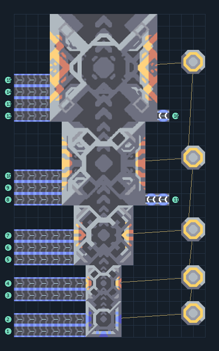

# omura — สายผลิตถึง T5

**UNIT-RISSO-T5** · 07 ยูนิต · 16×27 ช่อง · **ทดสอบระบบ**

RISSO T5  
โรงงานและเครื่องอัปเกรดต่อ payload ไว้ครบ เลือกยูนิตเริ่มต้นแล้ว เว้นพื้นที่ด้านบนให้ยูนิตออก  
ต่อวัตถุดิบเข้าขอบซ้ายแต่ละสายที่กำหนด ต้องมี Core และโควตายูนิต; รุ่น T4/T5 ต้องป้อนไครโอแยกแต่ละขั้น  
โรงงานเรือชั้นล่างต้องวางบนน้ำ/ริมฝั่ง เครื่องอัปเกรดต่อขึ้นฝั่ง ระวังช่องออกเรือตามแผนที่  
  
เข้า ซิลิคอน ที่ (0,0) → ขั้น T1 ใช้ 20/รอบ  
เข้า เมตากลาส ที่ (0,1) → ขั้น T1 ใช้ 35/รอบ  
เชื่อมไฟที่เสา (14,1)  
เข้า ซิลิคอน ที่ (0,3) → ขั้น T2 ใช้ 40/รอบ  
เข้า กราไฟต์ ที่ (0,4) → ขั้น T2 ใช้ 40/รอบ  
เข้า ซิลิคอน ที่ (0,6) → ขั้น T3 ใช้ 130/รอบ  
เข้า ไทเทเนียม ที่ (0,7) → ขั้น T3 ใช้ 80/รอบ  
เข้า เมตากลาส ที่ (0,8) → ขั้น T3 ใช้ 40/รอบ  
เข้า ซิลิคอน ที่ (0,11) → ขั้น T4 ใช้ 850/รอบ  
เข้า ไทเทเนียม ที่ (0,12) → ขั้น T4 ใช้ 750/รอบ  
เข้า พลาสตาเนียม ที่ (0,13) → ขั้น T4 ใช้ 650/รอบ  
เข้า ไครโอฟลูอิด ที่ (12,11) → T4 ต้องมี 60/วินาที  
เข้า ซิลิคอน ที่ (0,18) → ขั้น T5 ใช้ 1000/รอบ  
เข้า พลาสตาเนียม ที่ (0,19) → ขั้น T5 ใช้ 600/รอบ  
เข้า เซิร์จอัลลอย ที่ (0,20) → ขั้น T5 ใช้ 500/รอบ  
เข้า ผ้าเฟส ที่ (0,21) → ขั้น T5 ใช้ 350/รอบ  
เข้า ไครโอฟลูอิด ที่ (12,18) → T5 ต้องมี 180/วินาที  
ยูนิตออกด้านบนสุด; ต้นทุนและทรัพยากรแต่ละขั้นเพิ่มตามระดับ  
พิกัดจากซ้ายล่างเริ่ม 0 ก่อนหมุน  
ใช้ไฟสูงสุดตามสูตรรวมประมาณ 2892/วินาทีเมื่อเครื่องทำงานพร้อมกัน  
  
ผลทดสอบ Build 160.7: สร้าง omura ออกมาจริง 3 ตัวใน 1000 วินาที จากสายผลิตครบขั้น; ทดสอบการผลิต ไม่ใช่การรบ  
  
หมวด: 07 ยูนิต • Serpulo ไทย 2.0

**วัสดุก่อสร้าง:** ทองแดง 413 · ตะกั่ว 7013 · เมตากลาส 123 · ผ้าเฟส 1200 · พลาสตาเนียม 1050 · ซิลิคอน 4555 · เซิร์จอัลลอย 800 · ทอเรียม 2400 · ไทเทเนียม 2444

[ดาวน์โหลด .msch](../../schematics/UNIT-RISSO-T5.msch) · [รหัสนำเข้าจากคลิปบอร์ด](../../codes/UNIT-RISSO-T5.txt) · [กลับสารบัญ](../INDEX.md)

ภาพประกอบใช้กราฟิกบล็อกจากตัวเกม ไม่ใช่ภาพการรบระหว่างเล่นจริง ทางป้อนต้องจ่ายวัตถุดิบและไฟตามเงื่อนไขที่ระบุ
